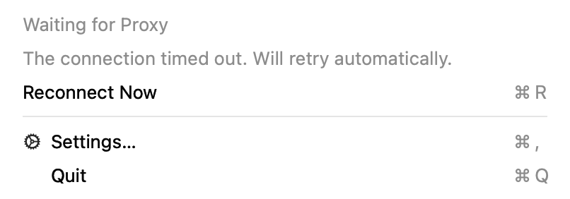
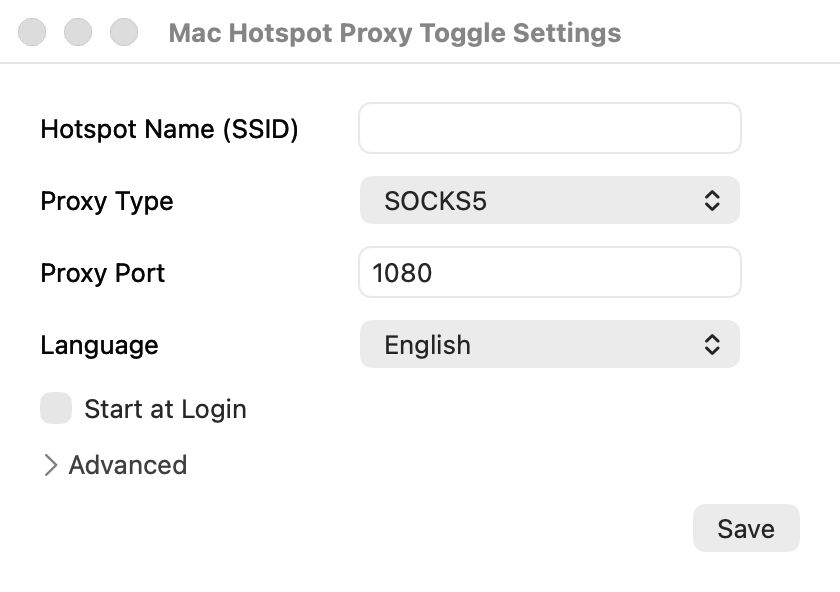

# mac-hotspot-proxy-toggle

[English](README.en.md) | [한국어](README.md)

<p>
  
</p>

**Connect to your phone’s hotspot and your Mac uses the phone’s proxy. Leave the hotspot and your previous proxy settings are restored.** Mac Hotspot Proxy Toggle is a menu bar utility for people who run a SOCKS5 or HTTP proxy server on their phone.



macOS applies proxy settings to the entire Wi-Fi service, so a proxy you enable on a hotspot can stay enabled at home or at work. Set the hotspot name, proxy type, and port once. The app finds the current router address and checks the proxy each time you connect.

| When | What happens on the Mac |
| --- | --- |
| Your hotspot has a new router address | The app checks the proxy at the new address and applies it. |
| You start the phone’s proxy after joining the hotspot | The app retries every 60 seconds by default. Choose **Reconnect Now** to try immediately. |
| You return to home or office Wi-Fi | The app restores the settings it changed and preserves any settings you edited yourself. |

Open the menu to see whether the proxy settings were applied, the response timed out, or the server requires authentication. The phone must run a proxy that accepts connections without authentication.

## Quick Install

### Use the menu bar app

```bash
git clone https://github.com/plaonn/mac-hotspot-proxy-toggle.git
cd mac-hotspot-proxy-toggle
HOTSPOT_MENU_BAR=1 PROXY_PORT=1080 ./install.sh
```

Open **Settings…** from the menu bar and save your phone’s **Hotspot Name (SSID)**, **Proxy Type**, and **Proxy Port**. Port `1080` is an example. Use the port configured on your phone. On Macs that hide the Wi-Fi name, allow Location access so the app can identify the hotspot. The app does not collect location coordinates.



### Run in the background with Homebrew

```bash
brew trust --formula plaonn/tap/hotspot-proxy-toggle
brew install plaonn/tap/hotspot-proxy-toggle
mkdir -p ~/.config
cp -n "$(brew --prefix)/etc/hotspot-proxy-toggle.conf.example" ~/.config/hotspot-proxy-toggle.conf
${EDITOR:-vi} ~/.config/hotspot-proxy-toggle.conf
brew services start plaonn/tap/hotspot-proxy-toggle
```

Run one reconciliation immediately:

```bash
hotspot-proxy-toggle run
```

See [docs/INSTALL.md](docs/INSTALL.md) for detailed install options.

## Configuration

Config file:

```text
~/.config/hotspot-proxy-toggle.conf
```

Core values:

```bash
PROXY_TYPE=socks5
PROXY_PORT=1080
HOTSPOT_SSID='My Phone'
REQUIRE_PROXY_CHECK=1
```

- `PROXY_TYPE=socks5`: configures the macOS SOCKS firewall proxy.
- `PROXY_TYPE=http`: configures HTTP/HTTPS Web Proxy by enabling Web Proxy and Secure Web Proxy on the same host/port.
- `HOTSPOT_SSID`: exact single phone hotspot SSID.
- `REQUIRE_PROXY_CHECK=1`: enables macOS proxy settings only when the proxy endpoint responds.

See [docs/CONFIG.md](docs/CONFIG.md) for all settings.

## Status Icons


The menu bar item is icon-only by default. It follows macOS template icon behavior, so state is expressed with alpha and knockout shapes instead of fixed colors.

| State | Meaning |
| --- | --- |
| Filled phone | Hotspot proxy is on |
| Outline phone | Non-hotspot or idle |
| Filled phone with slash | Hotspot detected, but proxy is unavailable |

See [docs/UI.md](docs/UI.md) for menu bar, `Mac Hotspot Proxy Toggle.app`, notification, and Settings behavior.

## Check

```bash
hotspot-proxy-toggle status
/usr/sbin/networksetup -getsocksfirewallproxy Wi-Fi
```

Dry-run without changing macOS proxy settings:

```bash
PROXY_PORT=1080 DRY_RUN=1 ./bin/hotspot-proxy-toggle run
```

## Docs

- [docs/INSTALL.md](docs/INSTALL.md): install, LaunchAgent, source install, uninstall.
- [docs/CONFIG.md](docs/CONFIG.md): config file, backends, notifications.
- [docs/UI.md](docs/UI.md): menu bar, app icon, status icons.
- [docs/DEVELOPMENT.md](docs/DEVELOPMENT.md): validation, build, release.
- [docs/SPEC.md](docs/SPEC.md): current implementation contract.
- [docs/ROADMAP.md](docs/ROADMAP.md): public future direction.

## Development

```bash
./scripts/validate.sh
```

See [docs/DEVELOPMENT.md](docs/DEVELOPMENT.md) for the full development workflow.
