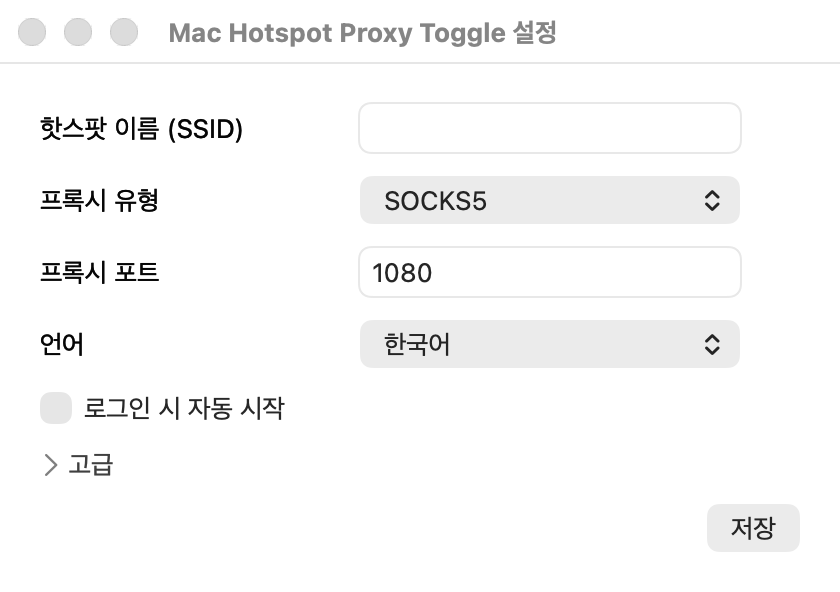
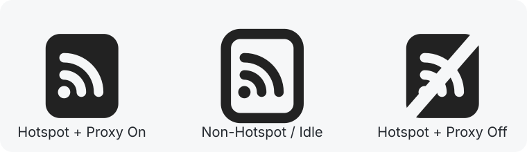

# mac-hotspot-proxy-toggle

[English](README.en.md) | 한국어

<p>
  
</p>

**휴대폰 핫스팟에 연결하면 Mac이 휴대폰의 프록시를 사용하고, 핫스팟을 떠나면 기존 프록시 설정으로 돌아갑니다.** 휴대폰에서 SOCKS5 또는 HTTP 프록시 서버를 실행하는 사람을 위한 macOS 메뉴바 유틸리티입니다.


macOS는 프록시 설정을 Wi-Fi 서비스 전체에 적용합니다. 그래서 핫스팟에서 켠 프록시가 집이나 회사 Wi-Fi에서도 남을 수 있습니다. 이 앱에 핫스팟 이름과 프록시 종류·포트를 한 번 입력하면, 연결할 때마다 현재 라우터 주소를 찾아 프록시가 응답하는지 확인합니다.

| 이런 상황에서 | Mac이 하는 일 |
| --- | --- |
| 같은 핫스팟에 다시 연결했는데 주소가 바뀌었을 때 | 새 주소로 프록시를 확인하고 Mac에 적용합니다. |
| 핫스팟에 먼저 연결하고 휴대폰 서버를 나중에 켰을 때 | 기본 60초 간격으로 다시 확인합니다. 메뉴에서 **지금 다시 연결**을 누르면 바로 시도합니다. |
| 집이나 회사 Wi-Fi로 돌아왔을 때 | 앱이 변경한 프록시 설정을 복원합니다. 사용자가 중간에 직접 바꾼 항목은 유지합니다. |

메뉴를 열면 Mac에 설정이 적용됐는지, 응답을 기다리는 중인지, 서버가 인증을 요구하는지 확인할 수 있습니다. 휴대폰에는 인증 없이 접속할 수 있는 프록시 서버가 준비되어 있어야 합니다.

## 빠른 설치

### 메뉴바 앱으로 사용하기

```bash
git clone https://github.com/plaonn/mac-hotspot-proxy-toggle.git
cd mac-hotspot-proxy-toggle
HOTSPOT_MENU_BAR=1 PROXY_PORT=1080 ./install.sh
```

메뉴바에서 **설정…**을 열고 휴대폰의 **핫스팟 이름 (SSID)**, **프록시 유형**, **프록시 포트**를 저장합니다. 위 명령의 `1080`은 예시이므로 서버가 사용하는 포트로 바꿀 수 있습니다. macOS가 Wi-Fi 이름을 숨기는 환경에서는 앱에 위치 권한을 허용해야 이름을 읽을 수 있습니다. 앱은 위치 좌표를 수집하지 않습니다.



### Homebrew로 백그라운드에서 사용하기

```bash
brew trust --formula plaonn/tap/hotspot-proxy-toggle
brew install plaonn/tap/hotspot-proxy-toggle
mkdir -p ~/.config
cp -n "$(brew --prefix)/etc/hotspot-proxy-toggle.conf.example" ~/.config/hotspot-proxy-toggle.conf
${EDITOR:-vi} ~/.config/hotspot-proxy-toggle.conf
brew services start plaonn/tap/hotspot-proxy-toggle
```

즉시 한 번 실행:

```bash
hotspot-proxy-toggle run
```

자세한 설치 옵션은 [docs/INSTALL.md](docs/INSTALL.md)에 있습니다.

## 최소 설정

설정 파일:

```text
~/.config/hotspot-proxy-toggle.conf
```

핵심 값:

```bash
PROXY_TYPE=socks5
PROXY_PORT=1080
HOTSPOT_SSID='My Phone'
REQUIRE_PROXY_CHECK=1
```

- `PROXY_TYPE=socks5`: macOS SOCKS firewall proxy를 설정합니다.
- `PROXY_TYPE=http`: HTTP/HTTPS Web Proxy를 설정합니다. Web Proxy와 Secure Web Proxy를 같은 host/port로 함께 켭니다.
- `HOTSPOT_SSID`: 정확히 매칭할 단일 휴대폰 핫스팟 SSID입니다.
- `REQUIRE_PROXY_CHECK=1`: proxy endpoint가 실제 응답할 때만 macOS proxy setting을 켭니다.

전체 설정 설명은 [docs/CONFIG.md](docs/CONFIG.md)에 있습니다.

## 상태 아이콘



Menu bar item은 기본적으로 아이콘만 표시합니다. macOS template icon 규칙에 맞춰 색상 대신 alpha와 knockout shape으로 상태를 구분합니다.

| 상태 | 의미 |
| --- | --- |
| 채워진 휴대폰 | 핫스팟 프록시를 사용 중입니다. |
| 외곽선 휴대폰 | 현재 Wi-Fi가 설정한 핫스팟이 아니거나 대기 중입니다. |
| 대각선이 있는 채워진 휴대폰 | 핫스팟은 감지됐지만 프록시를 사용할 수 없습니다. |

Menu bar, `Mac Hotspot Proxy Toggle.app`, notification, Settings 동작은 [docs/UI.md](docs/UI.md)에 있습니다.

## 확인

```bash
hotspot-proxy-toggle status
/usr/sbin/networksetup -getsocksfirewallproxy Wi-Fi
```

macOS 프록시 설정을 바꾸지 않고 dry-run으로 확인:

```bash
PROXY_PORT=1080 DRY_RUN=1 ./bin/hotspot-proxy-toggle run
```

## 문서

- [docs/INSTALL.md](docs/INSTALL.md): 설치, LaunchAgent, source install, 제거.
- [docs/CONFIG.md](docs/CONFIG.md): 설정 파일, backend, notification.
- [docs/UI.md](docs/UI.md): menu bar, app icon, 상태 아이콘.
- [docs/DEVELOPMENT.md](docs/DEVELOPMENT.md): 개발 검증, 빌드, release.
- [docs/SPEC.md](docs/SPEC.md): 현재 구현 contract.
- [docs/ROADMAP.md](docs/ROADMAP.md): 공개 가능한 future direction.

## 개발

```bash
./scripts/validate.sh
```

더 자세한 개발 workflow는 [docs/DEVELOPMENT.md](docs/DEVELOPMENT.md)에 있습니다.
