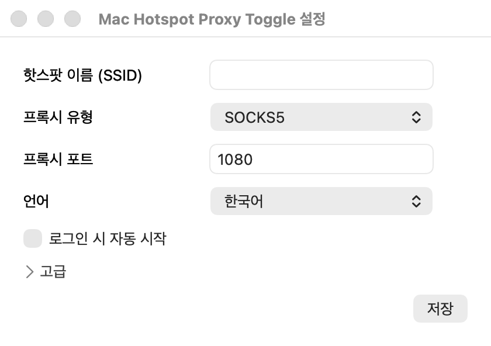

# UI

<p>
  
</p>

Mac Hotspot Proxy Toggle은 menu bar companion과 `Mac Hotspot Proxy Toggle.app`을 제공합니다. 핵심 프록시 판단과 macOS proxy write는 계속 `hotspot-proxy-toggle run`이 담당하고, UI는 상태 표시와 사용자의 즉시 실행 진입점 역할만 합니다.

## Menu Bar Companion


메뉴 첫 줄에서 현재 상태를 확인합니다. 핫스팟에서 프록시 응답을 기다리는 동안에는 실패 이유와 `지금 다시 연결`이 나타납니다. 자동 재시도가 활성 상태이면 기다려도 된다고 안내합니다. 버튼을 누르면 즉시 다시 시도합니다. 서버가 인증을 요구하면 인증 없는 프록시만 지원한다고 안내합니다. `설정…`에서 접속 정보를 바꿀 수 있고, `종료`를 선택하면 기존 프록시 설정을 복원합니다.

UI state JSON 기본 경로:

```text
~/Library/Application Support/hotspot-proxy-toggle/status.json
```

이 파일에는 SSID, router IP, local path를 넣지 않습니다.

macOS가 command-line SSID를 숨기는 환경에서는 app이 위치 권한을 요청하고 CoreWLAN으로 현재 SSID를 읽습니다. 이 값은 UI state와 분리된 private Wi-Fi identity cache에 저장되며, runtime은 현재 Wi-Fi device와 `ConnectionID`가 cache와 모두 같을 때만 사용합니다.

## 상태 아이콘


Menu bar status item은 기본적으로 상태 아이콘만 표시합니다. `MENU_BAR_TITLE`을 지정하면 title 옆에 아이콘을 표시합니다.

```bash
HOTSPOT_MENU_BAR=1 MENU_BAR_TITLE="Mac Hotspot Proxy Toggle" MENU_BAR_REFRESH_SECONDS=60 PROXY_PORT=1080 ./install.sh
```

아이콘은 같은 휴대폰 핫스팟 glyph를 세 가지 형태로 구분합니다.

| 아이콘 | 의미 |
| --- | --- |
| 채워진 휴대폰 | 핫스팟 프록시를 사용 중입니다. |
| 외곽선 휴대폰 | 현재 Wi-Fi가 설정한 핫스팟이 아니거나 핫스팟 프록시가 대기 중입니다. |
| 대각선이 있는 채워진 휴대폰 | 핫스팟은 감지됐지만 프록시를 사용할 수 없습니다. |

macOS menu bar icon은 template image이므로 색상은 macOS가 정하고, glyph의 alpha와 knockout shape만 상태를 표현합니다.

## Menu Status

연결됨은 Mac에 핫스팟 프록시 설정이 적용됐다는 뜻입니다. 대기 중에는 인증 요구, 응답 시간 초과, 예상 밖의 응답 또는 연결 확인 실패를 표시합니다. Wi-Fi 이름을 확인할 수 없는 경우와 다른 Wi-Fi에 연결된 경우를 구분합니다.

## Mac Hotspot Proxy Toggle.app

`Mac Hotspot Proxy Toggle.app`은 Finder, Spotlight, Launchpad에서 실행할 수 있는 LSUIElement app입니다. Dock icon을 띄우지 않고 menu bar item만 표시합니다.

App bundle은 핫스팟 프록시 켜짐 상태 glyph를 기반으로 한 아이콘을 사용합니다. Notification은 가능하면 이 app sender를 사용해 같은 app icon으로 표시되게 시도합니다.

## Settings



Settings window는 아래 main settings만 노출합니다.

- `핫스팟 이름 (SSID)`: 단일 휴대폰 핫스팟 SSID.
- `프록시 유형`: `SOCKS5` 또는 `HTTP/HTTPS Web Proxy`.
- `프록시 포트`: 휴대폰 핫스팟 router IP에서 proxy server가 listen하는 port.
- `언어`: `System Default`, `English`, `한국어`.
- `로그인 시 자동 시작`: background helper와 menu bar app의 login 자동 시작을 함께 켜거나 끄는 단일 toggle. 저장 중 현재 열려 있는 menu app은 종료하지 않습니다.

고급은 처음에 접혀 있습니다. 펼치면 프록시 확인 제한시간과 자동 재시도 간격을 조정하거나 설정 파일과 로그를 열 수 있습니다. 핫스팟 이름이 비어 있으면 저장하기 전에 입력란에 안내합니다. 창을 닫고 다시 열면 마지막 저장값이 표시되고, 언어를 저장하면 메뉴 전체가 즉시 갱신됩니다.

`NETWORK_SERVICE`와 `WIFI_DEVICE`는 기본적으로 자동 감지하며 Settings에 일반 설정으로 노출하지 않습니다.
